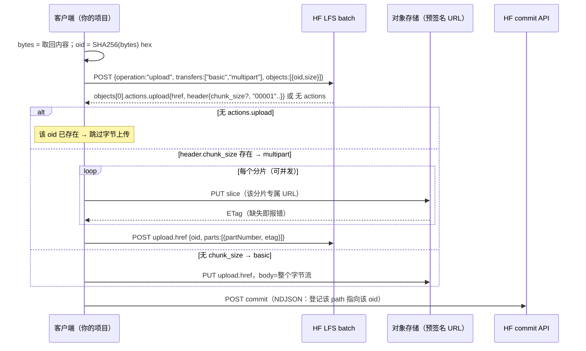

# 用 HuggingFace 私有仓库做对象存储 / 归档后端（Agent 通用实现指南）

> **本文档不依赖任何具体项目**。它描述的是 HuggingFace Hub 的 HTTP 协议契约，以及一套可移植到任何语言/运行时的"私有仓库归档"设计模式。读完应当能在任意项目里实现：把二进制与小文本产物写进一个 HF 私有仓库、在自有数据库里只保存路径指针、失败时静默降级。

## 0. 阅读约定：每条断言的可信度

实现网络协议最怕把"某次能跑"当成"契约"。本文对每条关键断言标注等级：

| 标记 | 含义 |
|---|---|
| `[官方]` | HF Hub API / git-lfs spec 明文，或 HF 官方 SDK（`huggingface_hub`、`huggingface.js`）源码可见 |
| `[实证]` | 已在生产环境（Serverless + 私有 dataset 仓库，纯 `fetch` 零 SDK）长期稳定运行的实现验证 |
| `[推断]` | 由协议语义/SDK 行为合理推出，官方未明文，**移植时需自行验证** |
| `[自查]` | 会随 HF 策略变化的配额、限额数字，动手前查 <https://huggingface.co/docs/hub/storage-limits> |
| `[需核实]` | 来自 SDK 用法或端点命名规律的合理外推，官方未逐条明文——**上线前用 §9 冒烟脚本验证** |
| `[安全]` | 工程通则（合规/密钥处理），与 HF 协议无关，但把数据交给外部存储时必须逐条过 |

## 1. 心智模型：HF 仓库到底是什么

一个 HF 仓库（model / dataset / space）本质是 **一个 git 仓库 + 一个大对象存储层（LFS 或 Xet）**，对外暴露 REST API。三条核心事实决定了所有设计：

1. **一次 commit = 一次 POST**。没有 multipart 会话、没有分块事务、没有 STS 临时凭证。一个 commit 可以带多个文件的增删改。
2. **文件只有两种存法**：
   - **inline**：内容直接进 git blob（`utf-8` 文本或 base64），只适合文本与小文件；
   - **LFS**：git 里存一段三行**指针文本**，真实字节在对象存储；由 `oid`（SHA-256 hex）寻址。
3. **路径即 key**。仓库内相对路径就是对象名，没有 bucket/prefix 概念，也没有 ACL。权限是整个仓库粒度的，靠 token 控制。

因此 HF 私有仓库适合当：**低成本、可人工浏览、天然带版本历史**的归档盘（备份、媒体留存、导出产物、数据集快照）。不适合当：**低延迟热读缓存**或**需要对象级权限/生命周期规则**的主存储。

### 什么时候选它，什么时候选 R2/S3/GCS

| 需求 | 选 HF 私有仓库 | 选对象存储 |
|---|---|---|
| 零月费 + 免费额度够（见 §7 `[自查]`） | ✅ | 通常也有免费层 |
| 人可以直接在网页里点开看/下载归档 | ✅ 强项 | ❌ 要另做控制台或签名 URL |
| 归档自带 git 历史（谁在什么时候改了这个文件） | ✅ | ❌ 要开版本控制 |
| 服务端高 QPS 热读、CDN 边缘读 | ❌ | ✅ |
| 对象级 ACL、生命周期规则、事件通知 | ❌ | ✅ |
| 运行环境无 SDK、无构建、只有裸 HTTP（Workers/Deno/edge） | ✅ 协议简单，裸 `fetch` 即可 | ✅ 但签名 V4 手写更麻烦 |
| 单次写入需要强事务一致 | ❌ 无事务 | 部分具备 |

## 2. 连接建立

### 2.1 凭证

需要 **一个对该仓库有写权限的 HF Access Token**（Settings → Access Tokens）。要点：

- Token 分 `read` / `write` / `admin` 三档粒度 `[官方]`：**`read` 档做 commit 会被拒**，必须 `write` 及以上。
- 认证方式只有一个 header：`Authorization: Bearer <HF_TOKEN>`。没有签名算法、没有时间戳、没有 region —— 这正是它能塞进任何语言/运行时而不引依赖的原因。
- 校验 token 与身份：`GET https://huggingface.co/whoami-v2`（带 Bearer）返回当前账号信息，可用于启动自检 `[官方]`（返回体字段 `[推断]`，只做 200/非 200 判断最稳）。
- **绝不**把 token 写进代码、配置文件、镜像层或日志；用平台的 Secret 机制注入（Cloudflare 是 Dashboard Secrets / `wrangler secret put`，K8s 是 Secret，CI 是 masked variable）。
- 同理注意：**很多"下载 URL"内嵌密钥**（例如某些消息平台把 token 拼在文件下载 URL 里）。这类 URL 永远不要 `console.log`、不要进错误信息、不要进 `query string` 日志。

### 2.2 三种仓库类型与端点推导

`model` / `dataset` / `space` 的 API 路径互不通用，必须显式区分。前缀约定（对齐官方 SDK 的 `url_prefix`）：

```
type=model    → api/models/…   与 https://huggingface.co/{repo}.git/…
type=dataset  → api/datasets/… 与 https://huggingface.co/datasets/{repo}.git/…
type=space    → api/spaces/…   与 https://huggingface.co/spaces/{repo}.git/…
```

**类型探测**（不想让用户多配一个变量时）：依次 `GET /api/datasets/{repo}` → `/api/models/{repo}` → `/api/spaces/{repo}`，带 Bearer，**第一个 2xx 的即类型** `[实证]`。私有仓库带 token 才可能 2xx，所以这一步同时验证了 token 权限；建议顺序 dataset→model→space（归档场景 dataset 语义最贴切，且没有 space 的构建副作用）。

工程注意（`[实证]`）：

- 探测结果要**缓存**（进程内 Map / TTL 缓存都行），否则每次上传多三次往返；serverless 下缓存是 per-isolate 的，冷启动会重探一次，可接受。
- 全失败要有兜底值，且**兜底也要写进缓存**，否则坏 token 会让每条业务消息都重试三遍（雪崩式放大）。
- 允许一个可选配置项（如 `HF_REPO_TYPE`）直接跳过探测——生产上省掉一次故障面。

### 2.3 端点总表

基址 `https://huggingface.co`；`{type}s` = `models|datasets|spaces`；`{prefix}` 见 2.2；`{rev}` 通常是分支名 `main`。

| 用途 | 方法 + 路径 | 备注 |
|---|---|---|
| 仓库信息 / 类型探测 | `GET /api/{type}s/{repo}` | 2xx 即存在且可读 |
| **提交文件** | `POST /api/{type}s/{repo}/commit/{rev}` | NDJSON，见 §3 |
| **询问该走哪条通道** | `POST /api/{type}s/{repo}/preupload/{rev}` | 返回每个文件的 `uploadMode` `[官方]` |
| **LFS batch（git 风格）** | `POST /{prefix}{repo}.git/info/lfs/objects/batch` | 标准 git-lfs batch endpoint，`[实证]` |
| LFS batch（REST 别名） | `POST /api/{type}s/{repo}/batch` | 新版 SDK 使用 `[官方]`；两者语义一致 |
| 下载内容（自动解析 LFS） | `GET /{prefix}{repo}/resolve/{rev}/{path}` | 私有仓库带 Bearer |
| 下载 git blob 原文 | `GET /{prefix}{repo}/raw/{rev}/{path}` | LFS 文件在此**只返回三行指针** |
| 列目录 | `GET /api/{type}s/{repo}/tree/{rev}/{dir}?recursive=true` | 分页 `[官方]` |
| 分支最新 commit | `GET /api/{type}s/{repo}/revision/{rev}` | 取 `parentCommit` 做 CAS `[官方]` |
| 建仓库 | `POST /api/repos/create` | `{"type","name","private":true}` `[官方]`；建议人工建好，程序不建 |

> `[官方]` commit 端点出于历史原因同时接受 `application/json` 与 `application/x-ndjson`，但官方推荐 NDJSON。NDJSON 也是大 payload 更省内存的写法（不必整体 stringify）。

## 3. 通道 A：inline 文本 commit

用于**纯文本**产物：JSON/NDJSON/CSV/Markdown/配置快照。**一次 POST 写完一个（或多个）文件。**

```http
POST /api/{type}s/{repo}/commit/main
Authorization: Bearer {HF_TOKEN}
Content-Type: application/x-ndjson

{"key":"header","value":{"summary":"backup 2026-11-26T04:00Z","description":"可选","parentCommit":"<可选 40 位 sha>"}}
{"key":"file","value":{"path":"backups/2026-11/db.ndjson","content":"<utf-8 文本>","encoding":"utf-8"}}
```

NDJSON 里可用的操作键 `[官方]`：`header`（必须、且必须第一行）、`file`（新增/覆盖）、`lfsFile`（登记已在 LFS 的对象，见 §4.4）、`deletedFile`、`movedFile`（含 `oldPath` → `path`）、`acceptedFile`（空间/PR 场景，归档用不到）。

要点：

- **每行一个 JSON 对象，行间用 `\n`**（末行 `\n` 可有可无 `[实证]`）。
- `encoding` 取 `"utf-8"` 或 `"base64"` `[官方]`。文本用 `utf-8` 最省（base64 膨胀 33%）。
- **不要用 inline 传二进制**：HF 会拒（典型报错含 `contains binary files` / `binary files must be uploaded with LFS`）`[实证]`。这是选 LFS 的**根本原因**，不是性能考虑。
- `summary` 建议带上目标路径（如 `` `db backup ${path}` ``），HF 网页的 commit 历史里一眼能定位文件 `[实证]`（纯人因优化）。
- inline 的大小上限官方未明文；经验值是**几 MB 以内**（≥5MB 的二进制一定被判 LFS，大 inline 文本会明显变慢甚至被拒）`[自查]`。稳妥做法：**给自己设一个硬阈值**（例：`> 5 MiB` 直接跳过或改走 LFS），并在代码里把它做成常量。
- 同一 commit 里写多文件是**原子的**（一个 commit）；跨 commit 无事务。

## 4. 通道 B：Git LFS 上传二进制

### 4.1 为什么必须走它

- inline 会拒二进制 `[实证]`；
- LFS 按内容 `oid` 寻址 → **天然去重**：同一字节流在同一个 HF 仓库里只存一份对象（乃至命中 HF 全站的内容寻址缓存），第二次上传只是再写一个指针 `[官方+实证]`；
- 大文件可分片（multipart），避开单请求体大小与超时问题。

### 4.2 流程



### 4.3 batch 请求/响应契约 `[官方]`（git-lfs batch spec + HF 扩展）

请求：

```json
{
  "operation": "upload",
  "transfers": ["basic", "multipart"],
  "hash_algo": "sha256",
  "objects": [{ "oid": "<64位hex>", "size": 123456 }],
  "ref": { "name": "main" }
}
```

- `Content-Type` 与 `Accept` 都是 `application/vnd.git-lfs+json`，外加 `Authorization: Bearer`。
- `hash_algo` 省略时默认按 sha256 处理；官方 SDK 发的是 `sha_256`，而 `[实证]` 的 `sha256` 同样被接受——**移植时按 `crypto.subtle` 的十六进制输出即可，别在这个字段上纠结**。
- `ref.name` 只是让服务端提前报错用（"does nothing for security"，SDK 注释原文 `[官方]`），可省。
- 一批可以问多个 object（SDK 每批 ≤100 个 `[官方]`）。归档路径通常单文件一次 commit，一问一答最简单。
- **不要**在 `transfers` 里请求 `"xet"`，除非你真的实现了 Xet 分片上传协议；请求了会拿到 `{actions:{refresh, verify}, meta.xet...}` 这套完全不同的流程 `[官方]`。只要 `basic`/`multipart` 就得到传统 LFS 通道。

响应关键字段（逐 object）：

| 字段 | 处理 |
|---|---|
| `objects[0].error` | **抛错**（`code`/`message`）。常见：未认证、仓库不可写、超过配额 |
| `objects[0].actions.upload` 缺失、且无 `error` | **不是错误**：内容已存在（`[官方]` SDK 注释 "Already uploaded"）。**跳过字节上传，但 commit 照做**——否则指针不会落到目标路径 `[实证]` |
| `actions.upload.href` | 上传目标 URL。basic 时是整文件 PUT 目标；multipart 时是 completion 端点 |
| `actions.upload.header.chunk_size` | 存在 → 走 multipart；值是分片字节数（字符串，需 parseInt） |
| `actions.upload.header` 的**纯数字键**（当前形如 `"00001"`…） | 每个分片各自的预签名 PUT URL。数字即 `partNumber`，分片下标 = `partNumber - 1` `[官方]` |
| `actions.upload.expires_at` / `expires_in` | URL 有效期，过期要重发 batch `[官方]` |
| `actions.verify` | 官方 spec 提供、SDK 默认不调用；跳过即可 `[官方]` |
| `actions.abort` | 若存在且你中途失败，可 POST 通知服务端清理（可省，孤儿对象无害） `[官方]` |

分片与合并（multipart）`[官方+实证]`：

```text
parts = Object.keys(header).filter(k => /^[0-9]+$/.test(k))     // 别假设位数，用正则
校验 parts.length === ceil(size / chunkSize)                     // SDK 会校验，建议照做
for part of parts:
    slice = bytes[(part-1)*chunkSize : part*chunkSize]
    PUT header[part] body=slice            → 必须拿到响应 ETag 头，缺 ETag 直接报错
POST actions.upload.href  {"oid":oid, "parts":[{"partNumber":1,"etag":"…"}, …]}
```

- **分片可并发**（SDK 用并发上限 5 `[官方]`），但**completion 的 parts 必须按 partNumber 有序**（SDK 用 `parts[N-1]` 占位赋值来保证顺序 `[官方]`）。
- 分片 URL 是一次性预签名，别缓存、别改写。
- **不要给分片 PUT 加 `Authorization`**：预签名 URL 自带凭证，多余的 auth 头有时会让对象存储签名校验失败 `[推断]`（`[实证]` 的实现就没带，工作正常）。

### 4.4 登记指针：两种写法都有效

**写法 1 —— 推荐，官方 SDK 用的 `lfsFile` 键 `[官方]`：**

```json
{"key":"lfsFile","value":{"path":"archive/2026-11/a.jpg","algo":"sha256","oid":"<hex>","size":123456}}
```

好处：不手写指针文本，而且 **commit 端点会自动更新仓库 `.gitattributes` 把该文件纳入 LFS 跟踪**（`huggingface.js` 的类型注释明文 `[官方]`）。

**写法 2 —— 直接把指针文本当普通文件 commit `[实证]`：**

```
version https://git-lfs.github.com/spec/v1
oid sha256:<64位hex>
size <字节数>
```

用 `{"key":"file","value":{"path":…,"content":<指针>,"encoding":"utf-8"}}` 提交。HF 服务端识别指针格式并解析，`resolve/` 下载能拿到真实字节 `[实证]`。

> ⚠️ **写法 2 的副作用 `[推断]`**：`resolve/` 读没问题，但若 `.gitattributes` 没有把该扩展名纳入 LFS 跟踪，用 `git clone` + `git lfs pull` 取回的人可能拿到三行指针而不是内容。要么用写法 1，要么自己在同一次 commit 里带上 `.gitattributes` 追加行（`*.jpg filter=lfs diff=lfs merge=lfs -text` 这种形式，注意 `archive/**` 这类目录级 pattern 更稳）。**这是移植时最容易漏的一条。**

### 4.5 可选通道 C：先问 `preupload`，让服务端裁决

不确定某文件会被判 inline 还是 LFS 时（文本里混了非 UTF-8、扩展名很冷门、想按服务端规则走），先问它 `[官方]`：

```http
POST /api/{type}s/{repo}/preupload/main
Content-Type: application/json

{"gitAttributes":"<可选：本次 commit 里的 .gitattributes 文本>",
 "files":[{"path":"a.bin","size":4096,"sample":"<前 512 字节的 base64>"}]}
```

响应里每个文件带 `uploadMode`，官方 SDK 的取值集合是 `regular`（inline）/ `lfs` / `multi_part` / `constant`（内容恒定，如空文件，**无需上传**）`[官方]`。

- `regular` → 用 §3 的 `key:"file"`；
- `lfs` / `multi_part` → 走 §4 的 batch（`multi_part` 意味着服务端会直接给分片方案）；
- `constant` → 什么都不用传，直接 commit（空文件的常见情形）。
- `sample` 只需前 512 字节，所以**流式来源也能问**（不必先全量下载）`[官方]`。
- 批量问，SDK 每 100 个一批 `[官方]`。

## 5. 可移植的架构设计（协议之外的部分）

### 5.1 路径（key）设计

三条规则，任何项目都适用：

1. **顶层前缀隔离用途**：`media/`、`backups/`、`exports/`、`logs/` 各占一个前缀，永不混用。混用会让"清理备份"顺带删掉媒体，或让目录统计、配额监控全错 `[实证]`。
2. **时间分桶**：`{prefix}/{YYYY-MM}/…`（UTC，从**事件自身时间**算，不是上传时刻）`[实证]`。收益：单目录条目数不爆（HF 建议每目录 <10k 条目、每仓库 <100k 文件 `[官方]`）、人工浏览有序、按前缀批量清理容易、老数据冷备份好定位。
3. **末段用稳定业务 ID，不用随机名**：`{业务实体}/{记录ID}_{类型}.{ext}`。这样"重传同一条记录"= 覆盖同一路径 = 幂等；否则重试会不断产生孤儿对象 `[实证]`。

扩展名兜底：来源有原名就用原名后缀（`/\.[A-Za-z0-9]{1,10}$/`，转小写），否则按类型映射固定表（`photo→jpg`、`voice→ogg`…），最后兜底 `bin` `[实证]`。路径必须由**服务端拼接**，绝不能把用户可控字符串直接当路径（`../` 穿越、超长名、非法字符）`[安全]`。

### 5.2 元数据指针放在你自己的库里

不要试图从 HF 反查业务状态。在自己的 DB / 对象元数据里存一行"归档记录"：

| 字段 | 用途 |
|---|---|
| `archive_key` | 仓库内相对路径，**原样存**，读回时不需任何拼接规则 `[实证]` |
| `content_hash` | SHA-256，去重、完整性校验、跨存储迁移对账 |
| `size` | 配额统计、下载预算 |
| `status` | `none` / `pending` / `ok` / `failed`（见 5.4） |
| `source_ref` | 来源侧的原始 ID（消息 file_id、S3 versionId…），降级时兜底 |
| `updated_at` | 重试节流 |

### 5.3 写入顺序：先落库，后上传，成功再回填

```
1) 同步写 DB（含 source_ref，archive_key = NULL）
2) 异步/后台任务：取字节 → 上传 → 得到 key
3) 仅在 key 真值时回填 DB；失败保持 NULL
```

理由（`[实证]`）：

- 归档是**尽力而为**的旁路，绝不能把用户可感知的响应时间绑在外部存储上；
- 回填只在成功时做 → 避免把已有好指针清空（"上传失败一次就把历史记录弄没"是真实故障形态）；
- 在 Serverless（Workers/Lambda/Cloud Functions）里用平台的"响应后继续执行"原语（`waitUntil` / `InvokeAsync` / 后台任务队列），并在进程退出前给它兜底 `catch`。

### 5.4 失败与降级策略

把"不可用"设计成**正常状态**而非异常：

- **未配置**（缺 token / 缺 repo）→ 直接返回 `null`，**不发任何请求、不打日志**（否则日志会被刷屏）`[实证]`。功能整体可关闭。
- **来源侧限制**（例如源 API 只允许下载 ≤20MB；某些平台的消息文件已被回收）→ 静默跳过，只留 `source_ref` `[实证]`。
- **超过你自己的预算**（单文件阈值、单次任务总量、每 commit 文件数）→ 跳过并计数 `[实证]`。
- **协议失败**（batch/PUT/commit 任一步）→ 抛到边界，边界统一 `warn` 一条**含足够上下文**的日志（仓库、类型、path、状态码、响应前 N 字符），对外仍返回 `null` `[实证]`。
- **不要静默吞掉影响用户可感知结果的失败**：日志是你唯一的排障入口。
- **重试**：HTTP `429`/`5xx` 指数退避（尊重 `Retry-After`），`4xx` 不重试；给整体重试设次数与总时长上限，避免后台任务无限堆积拖垮进程 `[实证]`。
- 可选进阶：`status='failed'` + 定时补偿任务扫描重传（需要 `content_hash` 才能安全去重）。

### 5.5 并发与一致性

- **同一分支并发 commit 没有事务保护**：不同路径并发一般安全；同一路径 last-write-wins `[推断]`。
- 想要 CAS：读当前 tip（`GET /revision/main` 或任一文件的 `commit_oid`），把它填进 `header.value.parentCommit`；冲突时服务端报错，重读再试 `[官方]`（字段存在；冲突行为 `[推断]`）。
- 高频写同一目录时，**合并 commit**（一次 `header` + 多个 `file`/`lfsFile`）比多次单文件 commit 更省、也更快，且避免 git 历史爆炸 `[官方]`。
- 多实例去重：协议层不提供幂等键，靠 5.1 的确定性路径 + 5.2 的 `content_hash` 达到"重复执行无害"。

### 5.6 读回 / 取回

| 场景 | 做法 |
|---|---|
| 程序内取单文件 | `GET /{prefix}{repo}/resolve/{rev}/{path}` + Bearer。**LFS 文件在 `resolve` 上会自动解析成真实字节** `[官方+实证]` |
| 只要指针/git 原文 | `…/raw/{rev}/{path}`（LFS 文件返回三行指针）`[官方]` |
| 指定历史版本 | `resolve/{40 位 commit sha}/{path}`；或对 `resolve` 发 `HEAD`，响应头带 `Etag` / `X-Repo-Commit`（官方 SDK 用它做缓存与 `If-None-Match`）`[官方]`；`GET /api/{type}s/{repo}/path/{rev}/{path}` 可拿 `sha`/`size`/`lfs.oid` 元数据 `[需核实]` |
| 列举 | `GET /api/{type}s/{repo}/tree/{rev}/{dir}?recursive=true`（注意分页与截断，SDK 用 `cursor`/`truncated` 参数取全量 `[官方]`） |
| 批量存在性 | `GET /api/{type}s/{repo}/paths?paths=a&paths=b` `[官方]`（SDK 用于对账） |
| 人工/批量取回 | `git lfs install` + `git clone https://huggingface.co/{prefix}{repo}`，凭证用 `hf auth login` / `huggingface-cli login` 或 git credential helper（**别把 token 嵌进 remote URL 再截图/贴日志**） |
| SDK | `huggingface_hub.hf_hub_download(repo_id, filename, repo_type="dataset", token=…)`；`huggingface.js` 的 `downloadFile`；都走同一 resolve 约定 `[官方]` |
| 临时外链 | `GET /datasets/{repo}/resolve/main/{path}?…` 不支持签名；要给用户临时下载，**由你的服务代读再转发**，或给该仓库换用只读 token `[推断]` |

LFS 的**下载**也是同一套 batch：`{"operation":"download","objects":[{oid,size}]}` → 每条给带有效期的 `actions.download.href` `[官方]`。除非你要绕开 resolve 直连对象存储，否则不需要。

### 5.7 删除与生命周期

- 删文件：NDJSON 里 `{"key":"deletedFile","value":{"path":"…"}}` `[官方]`。**LFS 对象不会被立即物理回收**（git 历史仍引用它）；要真正清盘只能删整个仓库重建 `[推断]`。
- 因此：**保留期必须在写入侧设计**（时间分桶 + 定期扫老月份 → `deletedFile`），而不是指望存储层 TTL。HF 没有对象级生命周期规则。
- 大版本清理/彻底清盘：`POST /api/repos/delete/{repo}` 后重建（人工操作，程序别自动删库）`[官方]`。

## 6. 限额速查

| 限制 | 值 | 标记 |
|---|---|---|
| 私有仓库存储配额（免费账号） | 约 100 GB；PRO 1 TB + 按量；Team 12 TB 起 | `[自查]` <https://huggingface.co/docs/hub/storage-limits> |
| 公开仓库存储 | 免费"尽力而为"，PRO 含 10 TB | `[自查]` 同上 |
| 推荐单文件大小 | < 20 GB（更大请分片） | `[官方]` repositories-recommendations |
| 推荐单仓库文件数 | < 100 k | `[官方]` 同上 |
| 推荐单目录条目数 | < 10 k | `[官方]` 同上（→ §5.1 时间分桶的理由） |
| 单 commit 文件数 | 无明文；实践上建议 ≤100（SDK 的分批粒度） | `[推断]` |
| inline 文本大小 | 无明文；经验 ≤5 MiB | `[自查]` / `[实证]` 阈值 |
| commit 端分支 | `main`（或你指定的分支名） | `[实证]` 新建仓库默认分支 |
| 上游来源限制 | 例：某消息平台 Bot API `getFile` 仅支持 ≤20 MB | **你的项目自己查**——这决定了"多大只留 `source_ref`" |

> 实现建议：把 §6 里所有数字做成**具名常量**（`MAX_INLINE_BYTES`、`MAX_LFS_BYTES`、`LFS_PART_CONCURRENCY`、`COMMIT_MAX_FILES`、`REPO_TYPE_CACHE_TTL`），并在代码注释里写明"这是配额熔断，不是魔法数"。

## 7. 参考实现（语言无关伪代码 → 直接可移植）

三个函数覆盖全部协议。任何有 `fetch`/HTTP 客户端 + SHA-256 的运行时都能直译（Node/Deno/Workers、Python httpx、Go net/http、Rust reqwest）。

```js
// ---- 0) 端点与类型 ----
const HF = "https://huggingface.co";
function urls(repo, type /* model|dataset|space */, rev = "main") {
  const plural = { model: "models", space: "spaces", dataset: "datasets" }[type] || "datasets";
  const prefix = type === "model" ? "" : `${plural}/`;           // model 不带前缀
  return {
    commit:  `${HF}/api/${plural}/${repo}/commit/${rev}`,
    preup:   `${HF}/api/${plural}/${repo}/preupload/${rev}`,
    batch:   `${HF}/${prefix}${repo}.git/info/lfs/objects/batch`,
    resolve: `${HF}/${prefix}${repo}/resolve/${rev}/`,           // + path
  };
}
const sha256hex = async (bytes) =>
  [...new Uint8Array(await crypto.subtle.digest("SHA-256", bytes))]
    .map(b => b.toString(16).padStart(2, "0")).join("");

// ---- 1) NDJSON commit ----
// entries: [{key:"file", value:{path,content,encoding}} | {key:"lfsFile", value:{path,algo,oid,size}} | {key:"deletedFile", value:{path}}]
async function commit({ token, url }, summary, entries) {
  const body = [JSON.stringify({ key: "header", value: { summary } }),
                ...entries.map(e => JSON.stringify(e))].join("\n");
  const r = await fetch(url, {
    method: "POST",
    headers: { Authorization: `Bearer ${token}`, "Content-Type": "application/x-ndjson" },
    body,
  });
  if (!r.ok) throw new Error(`HF commit ${r.status}: ${(await r.text().catch(() => "")).slice(0, 200)}`);
}

// ---- 2) 二进制 → LFS → 指针登记 ----
async function putBinary(ctx, path, bytes) {
  const oid = await sha256hex(bytes), size = bytes.length;
  const b = await fetch(ctx.batch, {
    method: "POST",
    headers: { Authorization: `Bearer ${ctx.token}`,
               Accept: "application/vnd.git-lfs+json",
               "Content-Type": "application/vnd.git-lfs+json" },
    body: JSON.stringify({ operation: "upload", transfers: ["basic", "multipart"],
                           hash_algo: "sha256", objects: [{ oid, size }] }),
  });
  if (!b.ok) throw new Error(`HF lfs batch ${b.status}: ${(await b.text()).slice(0, 200)}`);
  const obj = (await b.json())?.objects?.[0];
  if (obj?.error) throw new Error(`HF lfs object error: ${JSON.stringify(obj.error)}`);

  const up = obj?.actions?.upload;
  if (up) {                                                   // 无 up = 已存在，直接 commit
    const chunk = up.header?.chunk_size ? parseInt(up.header.chunk_size, 10) : 0;
    if (chunk) {
      const partKeys = Object.keys(up.header).filter(k => /^\d+$/.test(k))
        .sort((a, b) => parseInt(a, 10) - parseInt(b, 10));    // 键可能是 "00001"，别按字符串排序
      if (partKeys.length !== Math.ceil(size / chunk)) throw new Error("HF part count mismatch");
      const parts = new Array(partKeys.length);
      await Promise.all(partKeys.map(async (k) => {            // 可并发；建议限流 5
        const n = parseInt(k, 10);
        const pr = await fetch(up.header[k], { method: "PUT", body: bytes.subarray((n - 1) * chunk, n * chunk) });
        if (!pr.ok) throw new Error(`HF lfs part ${n} ${pr.status}`);
        const etag = pr.headers.get("etag");
        if (!etag) throw new Error(`HF lfs part ${n} missing etag`);
        parts[n - 1] = { partNumber: n, etag };                // 按号位写入 → 保证有序
      }));
      const cr = await fetch(up.href, { method: "POST",
        headers: { Authorization: `Bearer ${ctx.token}`, "Content-Type": "application/vnd.git-lfs+json" },
        body: JSON.stringify({ oid, parts }) });
      if (!cr.ok) throw new Error(`HF lfs completion ${cr.status}`);
    } else {
      const pr = await fetch(up.href, { method: "PUT", body: bytes });
      if (!pr.ok) throw new Error(`HF lfs put ${pr.status}`);
    }
  }
  await commit(ctx, `binary ${path}`,
    [{ key: "lfsFile", value: { path, algo: "sha256", oid, size } }]);   // §4.4 写法 1
  return path;
}

// ---- 3) 业务入口：可选开关 + best-effort ----
async function archivePut(env, { path, bytes, text }) {
  if (!env.HF_TOKEN || !env.HF_REPO) return null;              // 未配置 = 功能关闭，静默
  try {
    const type = env.HF_REPO_TYPE || await probeRepoType(env.HF_TOKEN, env.HF_REPO);  // 结果按 TTL 缓存
    const ctx = { token: env.HF_TOKEN, ...urls(env.HF_REPO, type) };
    if (bytes) {
      if (bytes.length > env.MAX_LFS_BYTES) return null;       // 超预算：跳过并让调用方留 source_ref
      return await putBinary(ctx, path, bytes);
    }
    if (new TextEncoder().encode(text).length > env.MAX_INLINE_BYTES) return null;
    await commit(ctx, `text ${path}`,
      [{ key: "file", value: { path, content: text, encoding: "utf-8" } }]);
    return path;
  } catch (e) {
    console.warn("HF archive failed:", env.HF_REPO, path, e?.message || e);  // 一定留线索
    return null;
  }
}
```

`probeRepoType`：见 §2.2（三个 GET 依次试、缓存、兜底 `dataset`、兜底也缓存）。

移植成 Python（`httpx` + `hashlib`）/ Go（`net/http` + `crypto/sha256`）时逐行对应即可，唯一要注意的运行时差异：

- **字节切片**：JS 用 `bytes.subarray(a,b)`（零拷贝视图）；Python 用 `data[a:b]`；Go 用 `data[a:b]`。
- **SHA-256**：WebCrypto 是异步的；Python/Go 同步。
- **`Content-Length`**：Go 里传 `bytes.NewReader` 会自动带上，某些对象存储分片 PUT **要求**准确的 Content-Length，别用流式 body 发分片 `[推断]`。

## 8. 把这套功能加到新项目的落地清单

按顺序做，每步都可验证：

1. **建仓库**：人工在 HF 上建 **私有** dataset 仓库（不要 model —— model 会误导别人以为有权重；不要 space —— space 有构建/部署副作用与隐藏限制）。记录 `repo_id`、确认默认分支 `main`。
2. **发 token**：`write` 级、**只授予该仓库**（fine-grained 最小权限）。存进平台 Secret，命名 `HF_TOKEN`；非敏感的 `HF_REPO` / `HF_REPO_TYPE` 放普通配置。
3. **定策略**：写出你的 §5.1 路径规范、§6 熔断常量、§5.4 降级矩阵，作为代码里的具名常量 + 一段注释。
4. **写三个函数**：`urls/probeRepoType` / `commit` / `putBinary` + 一个业务入口 `archivePut`（§7）。保持"未配置即静默关闭"。
5. **接元数据**：在你的 DB 加 `archive_key` / `content_hash` / `size` / `status` / `source_ref`（§5.2），并按 §5.3 的"先落库后上传成功回填"接线。
6. **旁路化**：把 `archivePut` 挂到后台任务 / `waitUntil` / 队列，主链路不等它。
7. **冒烟验证**（§9 全套跑通再谈上线）。
8. **写运维文档**：怎么人工取回、怎么按月份清理、`status='failed'` 怎么补。

## 9. 冒烟测试：一次跑通全协议

不需要业务代码，纯 curl 即可验证凭证、类型、inline、LFS、读回五条链路。

```bash
export HF_TOKEN=hf_xxx                       # write 级
export REPO=yourname/your-private-dataset
export API=https://huggingface.co/api/datasets/$REPO
export BATCH=https://huggingface.co/datasets/$REPO.git/info/lfs/objects/batch
export AUTH="Authorization: Bearer $HF_TOKEN"

# 1) token + 仓库可达（同时确认类型是 dataset）
curl -sf -H "$AUTH" "$API" >/dev/null && echo "repo+token OK"

# 2) inline 文本 commit（通道 A）
printf '%s\n%s\n' \
 '{"key":"header","value":{"summary":"smoke text"}}' \
 '{"key":"file","value":{"path":"selftest/hello.txt","content":"hello\n","encoding":"utf-8"}}' \
 | curl -sS -X POST -H "$AUTH" -H "Content-Type: application/x-ndjson" --data-binary @- "$API/commit/main"

# 3) inline 传二进制应被拒（反向验证 LFS 是否真的必要）
head -c 4096 /dev/urandom | base64 -w0 | \
  awk '{print "{\"key\":\"header\",\"value\":{\"summary\":\"smoke bin\"}}\n{\"key\":\"file\",\"value\":{\"path\":\"selftest/x.bin\",\"content\":\"" $0 "\",\"encoding\":\"base64\"}}"}' \
  | curl -sS -X POST -H "$AUTH" -H "Content-Type: application/x-ndjson" --data-binary @- "$API/commit/main"   # 期望 4xx，含 binary

# 4) 真二进制：算 oid → batch → PUT → commit(lfsFile)（通道 B）
head -c 1048576 /dev/urandom > selftest.bin
OID=$(sha256sum selftest.bin | cut -d' ' -f1); SIZE=$(stat -c%s selftest.bin)
curl -sS -X POST -H "$AUTH" -H "Accept: application/vnd.git-lfs+json" -H "Content-Type: application/vnd.git-lfs+json" \
  -d "{\"operation\":\"upload\",\"transfers\":[\"basic\",\"multipart\"],\"hash_algo\":\"sha256\",\"objects\":[{\"oid\":\"$OID\",\"size\":$SIZE}]}" \
  "$BATCH" | tee batch.json                                 # 看 actions / header.chunk_size / 是否已存在
# basic 分支（无 chunk_size 时）：
PUTURL=$(jq -r '.objects[0].actions.upload.href' batch.json)
curl -sS -X PUT --data-binary @selftest.bin "$PUTURL"
curl -sS -H "$AUTH" -H "Content-Type: application/x-ndjson" -X POST "$API/commit/main" \
  -d "{\"key\":\"header\",\"value\":{\"summary\":\"smoke lfs\"}}
{\"key\":\"lfsFile\",\"value\":{\"path\":\"selftest/x.bin\",\"algo\":\"sha256\",\"oid\":\"$OID\",\"size\":$SIZE}}"

# 5) 读回并校验字节一致
curl -sSL -H "$AUTH" "https://huggingface.co/datasets/$REPO/resolve/main/selftest/x.bin" -o back.bin
sha256sum selftest.bin back.bin                             # 两个 OID 必须相同
curl -sSL -H "$AUTH" "https://huggingface.co/datasets/$REPO/raw/main/selftest/x.bin"   # 期望看到三行 LFS 指针

# 6) 大文件触发 multipart：把 selftest.bin 换成 ~100MB 重跑第 4 步，
#    这时 batch 响应应出现 header.chunk_size 与数字键分片 URL → 按 §7 的分片循环处理

# 7) 清理
curl -sS -H "$AUTH" -H "Content-Type: application/x-ndjson" -X POST "$API/commit/main" \
  -d '{"key":"header","value":{"summary":"smoke cleanup"}}
{"key":"deletedFile","value":{"path":"selftest/hello.txt"}}
{"key":"deletedFile","value":{"path":"selftest/x.bin"}}'
```

功能验收清单（对应 §4 的坑）：

- [ ] 未配 token / repo：主链路完全不受影响，无多余日志。
- [ ] inline 文本能写、`raw` 能读到原文。
- [ ] 二进制走 LFS，`resolve` 读回**字节级一致**（sha256 对比），`raw` 读到指针文本。
- [ ] 同一份字节传到两个不同路径：第二次 batch **不返回 `actions.upload`**，但两个路径都可读 → 去重生效且指针没漏。
- [ ] 超过你的单文件阈值：返回 `null`、DB 保留 `source_ref`、主链路正常。
- [ ] 人为写错 token：得到明确的 `401/403` 日志行（含 repo 与状态码），不是静默消失。
- [ ] `git clone` 该仓库 + `git lfs pull`：文件是真实内容而非三行指针（验证 `.gitattributes` 是否被正确维护，见 §4.4 警告）。

## 10. 排障对照表

| 现象 / 错误串 | 根因 | 处置 |
|---|---|---|
| commit 返回 `401` / `403` | token 缺失、过期、只有 `read` 权限，或账号无该仓库写权限 | 换 `write` 级 token；确认仓库归谁、你是否是成员 |
| batch 返回 `404`（HTML 页） | 类型前缀错了（把 model 当 dataset 拼 URL） | 检查 §2.2 的 `prefix` 推导；或显式配置类型 |
| `404 repo not found` | `repo_id` 写错（大小写敏感、漏 namespace） | 核对 `GET /api/{type}s/{repo}` |
| commit `400: ... contains binary files` / `binary ... must use LFS` | 二进制走了通道 A | 改 §4 的 LFS 流程，或用 `preupload` 让服务端裁决 |
| commit `400: expected NDJSON` / `invalid header` | 用了 JSON 数组体、或漏了 `header` 行、或行分隔符不是 `\n` | 严格按 §3 两行格式；`--data-binary` 而非 `--data-urlencode` |
| LFS PUT 分片 `403 SignatureDoesNotMatch` | 给预签名 URL 多加了 `Authorization`/`Content-Type`，或分片字节范围错 | 分片 PUT 只带 body，别加 auth；核对 `partNumber-1` 对齐切片 |
| 分片 completion `400` / 合并后大小不对 | parts 顺序错、漏 etag、分片数与 `ceil(size/chunk_size)` 不符 | 按号位写入数组；加 SDK 那道 parts 计数校验 |
| commit 成功但 `resolve` 404 | path 拼错（大小写、多余 `/`、把 `rev` 当成路径一部分）；或 commit 到了别的分支 | 打印最终 path 对账；确认 §2.3 的 `resolve` 模板 |
| `resolve` 拿到三行指针而非内容 | 用了 `raw`；或内容被当成普通文本 commit（指针写进 `lfsFile` 之外又没上传字节） | 用 `resolve`；确认 §4 字节上传真的完成（oid 对得上） |
| 读回内容与写入不一致 | 上传时切片越界 / 把 base64 当字节上传 / oid 与实际字节不符 | 校验 `size` 与 sha256；分片用 `subarray` 而非 `slice(start,end)` 之外的偏移计算 |
| 上传"完全没日志"但没文件 | 命中了未配置/阈值/来源限制等**静默分支** | 这是设计使然；用 §9 清单逐条确认，必要时临时打开 debug 日志 |
| commit 偶发冲突 / `parent commit ... is not the current one` | 并发写同分支 | 带 `parentCommit` 并重读重试；或合并多个文件进一次 commit |
| 仓库体积暴涨、配额告警 | 反复覆盖大文件（git 历史保留旧版本）+ 对象不被物理回收 | §5.7：控制覆盖频率、按前缀清理、必要时重建仓库 |
| 上传很慢 / isolate 冷启动慢 | 每次都探测类型、或串行分片 | 缓存类型；分片并发限流 5（SDK 同值） |

## 11. 安全清单（把 HF 当外部存储时必须逐条过）

1. **仓库私有**：归档内容常含 PII / 业务数据。建仓时就 `private: true`，并在 CI/文档里加一条断言（`GET /api/{type}s/{repo}` 响应中 `private === true`）。
2. **最小权限 token**：单仓库 write，不给全局 admin；有轮换计划；泄漏即吊销。
3. **token 不进代码/配置/git/日志/错误信息**。检查所有 `console.error`/异常文本，别把 headers 整个打出来。
4. **路径由服务端拼接**：用户可控字符串必须白名单化（只留 `[A-Za-z0-9_.-]`）、拒绝 `..`、限制段长与总长；ID 用平台原始数字 ID 而非用户名。
5. **含密钥的下载 URL 不当日志、不当查询参数**（见 §2.1）。
6. **完整性**：`content_hash` 落库；取回时（尤其给用户/给下游系统）校验 sha256。
7. **不存放不该存的东西**：密钥、明文密码、超过合规期限的用户数据；给"删除用户"流程加上按前缀清理的归档删除步骤（GDPR/个保法口径下的"删除"必须覆盖归档，`[安全]`）。
8. **限速与预算**：外部存储不可用时的熔断要能保护你自己（后台任务队列堆积、内存里堆字节都会打挂进程）——宁可丢弃并记状态，也不要无界排队。
9. **供应链**：裸 HTTP 无依赖，本身就是优势；若引入 SDK，注意 `huggingface_hub` / `huggingface.js` 的行为（自动 .gitattributes 处理、并发数）并在代码评审里核对。

## 12. 与官方 SDK 的取舍

| 方案 | 适用 | 代价 |
|---|---|---|
| **裸 HTTP（本文）** | Serverless/边缘、零依赖要求、只需"写对象 + 写文本"、想精确控制超时与熔断 | 协议细节自己维护；HF 改动需跟 |
| `huggingface_hub`（Python） | 训练/数据管线、需要重试/进度/并发调优 | 引入依赖与网络栈，冷启动更重 |
| `huggingface.js` `@huggingface/hub` | Node/Bun/Workers 前端 | 需要其 Blob 语义，Xet 默认路径更复杂 |
| git + git-lfs CLI | 一次性人工迁移/审计/批量取回 | 有状态文件系统，不适合请求路径 |

选裸 HTTP 时的**最低保障**：NDJSON 两行格式、`uploadMode`/`actions.upload` 缺失的语义处理、multipart 的数字键与有序 parts、以及 §4.4 的 `.gitattributes` 后果。这四点本文已给全，可直接照 §9 验证。

---

## 参考来源

- HF Hub OpenAPI（含 commit / preupload 端点与 NDJSON payload 说明）：<https://huggingface.co/.well-known/openapi.md>
- 存储配额：<https://huggingface.co/docs/hub/storage-limits> ｜ 仓库规模建议：<https://huggingface.co/docs/hub/repositories-recommendations>
- 官方实现（协议细节最可靠的交叉验证材料）：
  - `huggingface.js`：`packages/hub/src/lib/commit.ts`、`packages/hub/src/types/api/api-commit.ts`
  - `huggingface_hub`（Python）：`src/huggingface_hub/_commit_api.py`、`lfs.py`
- git-lfs Batch API 规范：<https://github.com/git-lfs/git-lfs/blob/main/docs/api/batch.md> ｜ LFS 指针格式：<https://github.com/git-lfs/git-lfs/blob/main/docs/spec.md>
- 本文 `[实证]` 部分来自一个已上线实现：Cloudflare Workers 上零依赖 `fetch` 完成"通道 A（NDJSON 文本 commit）+ 通道 B（LFS basic/multipart）"，用于媒体留存与数据库备份双投递，长期稳定。
